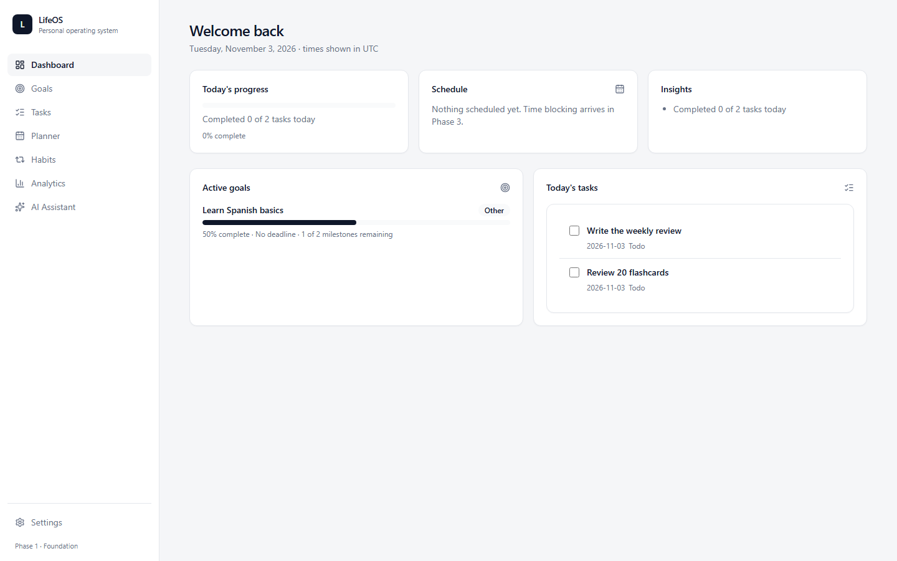
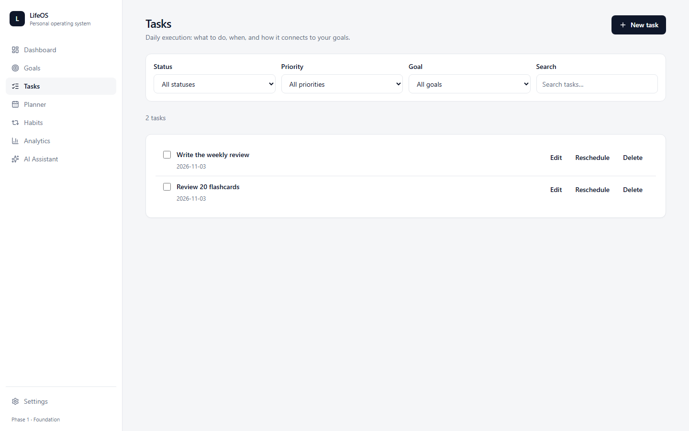

# LifeOS

Персональная операционная система для целей, задач, планирования и прогресса.

> LifeOS should adapt to your life, not force your life to adapt to a schedule.

## Статус

**Phase 1 — Foundation — done** (итерация 1.2 закрыта 2026-11-03): структура проекта,
роутинг, layout, дизайн-токены, доменные типы, утилиты дат/прогресса, Supabase Auth
(регистрация/вход/выход/восстановление/подтверждение email), профиль и `user_preferences`,
защищённые роуты, onboarding-диалог, unit-тесты (Vitest) + e2e (Playwright).

**Phase 2 — Goals & Tasks — done** (итерация 2 закрыта 2026-11-04): цели (CRUD, статусы,
архивирование, удаление с отвязкой задач), этапы (CRUD, позиции, пересчёт прогресса),
задачи (CRUD, фильтры, сортировка, связи с целью и этапом, перенос даты), дашборд
на реальных данных. Повторения отложены в Phase 2.5, полноценная история цели
(`goal_events`) — в Phase 3+.

**Phase 2.5 — Recurrence — done** (закрыта 2026-11-04): повторяющиеся задачи
(daily/weekly/weekdays), eager-генерация на 30 дней + докатка при входе,
идемпотентность через read-then-insert (частичный уникальный индекс PostgREST
не выражает), бейдж Repeat, правка экземпляра отвязывает серию.

Следующий шаг: Phase 3 — Planner (см. [docs/ROADMAP.md](docs/ROADMAP.md)).

Почта: подтверждение email выключено **по решению владельца, бессрочно** (`Confirm email = OFF`,
исходящих писем нет). Custom SMTP и включение подтверждения — только по прямой просьбе
владельца, см. `docs/plan.md`, итерация 3.

## Live demo

Прод-деплой — Vercel, авто-деплой из ветки `main` (конфиг SPA-rewrite в `vercel.json`).

**URL:** `https://lifeos-sepia-mu.vercel.app`

### Demo account

На экране `/sign-in` — кнопка «Explore the demo account»: вход в общий демо-аккаунт
(shared demo account) с примерами целей и задач. Данные одноразовые — любой
посетитель может их менять. Восстановить после чужих правок:
`node scripts/seed-demo.mjs` (предварительно посмотреть план:
`node scripts/seed-demo.mjs --dry-run`).

Демо-аккаунт отдельный от e2e-аккаунта: демо создано для людей, e2e — для
автотестов. Креды демо лежат только в env (`VITE_DEMO_EMAIL` /
`VITE_DEMO_PASSWORD`, Vercel → Production и Preview).

### Email

Подтверждение email выключено (confirmation disabled, `Confirm email = OFF`). Это решение
владельца, а не временная настройка демо: проект живёт без исходящей почты, пока владелец
сам не включит custom SMTP. Регистрация сразу попадает в приложение, без письма.

Обратная сторона, которую нужно знать: письма не уходят вообще — восстановление пароля,
повторная отправка подтверждения, invite и magic link не работают; password reset requires
custom SMTP (сброс — только через Supabase Dashboard → Users). `/reset-password` при этом
показывает нейтральное «письмо отправлено», хотя письмо не отправится — это осознанно
принятое ограничение, а не баг.

## Скриншоты




## Что работает

- Auth: регистрация, вход, выход, onboarding — часовой пояс и время подъёма/отбоя.
  Подтверждение email выключено по решению владельца: регистрация сразу попадает
  в приложение (подробности — раздел «Email» выше). На `/sign-in` —
  кнопка «Explore the demo account» (общий демо-аккаунт, только когда заданы
  `VITE_DEMO_*`).
- Цели: CRUD, статусы `not_started/active/paused/completed/archived`, прогресс
  ручной или по этапам (переключение не стирает ручное значение); удаление
  отвязывает задачи (`SET NULL`, их число показано в диалоге), этапы удаляются
  каскадно, задачи — никогда.
- Этапы: CRUD, порядок через `position`, завершение ставит `completed_at`;
  статусы только `pending/completed`.
- Задачи: CRUD, статусы `todo/in_progress/completed/cancelled`, приоритеты,
  фильтры (статус/приоритет/цель/поиск), сортировка «дата → приоритет → создание»
  с лимитом 500, перенос даты, reopen; overdue — вычисляемое состояние в поясе
  пользователя, а не статус в БД.
- Дашборд на реальных данных: прогресс дня, сегодняшние задачи (завершение
  в один клик), активные цели с прогрессом и остатком этапов, детерминированные
  Insights без «AI»; расписание — честная заглушка до Phase 3.
- Безопасность: RLS на всех пользовательских таблицах (`user_id = auth.uid()`),
  identity только из проверенного JWT, `service_role` нигде не используется.
- Проверки: 294 unit-тестов (Vitest + RTL), live e2e (auth/goals/tasks/dashboard/
  smoke/recurrence) против реального Supabase-проекта; `typecheck`, `lint`, `build` зелёные.

Полное техническое задание — [docs/PRD.md](docs/PRD.md).
Архитектурные решения — [docs/ARCHITECTURE.md](docs/ARCHITECTURE.md).

## Требования

- Node.js **>= 22.12** (проверено на 24.x)
- npm 11+
- Аккаунт Supabase (для auth и данных)

## Быстрый старт

```bash
npm install
cp .env.example .env.local   # Windows: Copy-Item .env.example .env.local
npm run dev
```

Откройте http://localhost:5173. Пока `.env.local` не заполнен, приложение показывает
баннер «Supabase is not connected» — это ожидаемое поведение, а не ошибка.

### Переменные окружения

| Переменная               | Где взять                         | Примечание                                        |
| ------------------------ | --------------------------------- | ------------------------------------------------- |
| `VITE_SUPABASE_URL`      | Supabase → Project Settings → API | Публичный URL проекта                             |
| `VITE_SUPABASE_ANON_KEY` | Supabase → Project Settings → API | Публичный anon key, безопасен только вместе с RLS |

`service_role` key и ключи AI-провайдеров **никогда** не попадают во frontend.

### Supabase Auth: Redirect URLs

Регистрация и повторная отправка письма возвращают пользователя на `<origin>/`
(дефолт `emailRedirectTo` в `signUp`/`resendConfirmation`), восстановление пароля —
на `<origin>/reset-password`. Все эти URL обязаны быть в allow-list, иначе письмо
уведёт на project Site URL (по умолчанию `localhost:3000`):

Supabase Dashboard → Authentication → URL Configuration → Redirect URLs → добавить:

- `http://localhost:5173/` и `http://localhost:5173/reset-password` (локальная разработка)
- `http://127.0.0.1:5173/` и `http://127.0.0.1:5173/reset-password` (Playwright ходит через `127.0.0.1`)
- `https://<ваш-домен>/` и `https://<ваш-домен>/reset-password` (production)

## Как проверить локально

```bash
Copy-Item .env.example .env.local   # заполнить VITE_SUPABASE_URL / VITE_SUPABASE_ANON_KEY
Copy-Item .env.e2e.example .env.e2e # заполнить E2E_EMAIL / E2E_PASSWORD (подтверждённый пользователь)
                                 # + E2E_SIGNUP_EMAIL (реальный ящик для sign-up теста)
npm run dev                          # http://localhost:5173
npm run typecheck; npm run lint; npm test
npx playwright install chromium      # один раз для e2e
npm run test:e2e
node scripts/verify-rls.mjs         # ручная проверка RLS, только anon key
```

- `service_role` нигде не нужен и не используется — ни в приложении, ни в тестах, ни в скриптах.
- Без `E2E_EMAIL` / `E2E_PASSWORD` e2e-файл скипается целиком, поэтому CI без секретов не падает.
- Каждый e2e-тест работает в чистом контексте браузера: сессии между сценариями не протекают.
- `sign-up` e2e-тест регистрирует `+`-алиас реального ящика из `E2E_SIGNUP_EMAIL`
  (при `Confirm email = OFF` сразу попадает в приложение; письма не ждёт и не
  открывает). Без `E2E_SIGNUP_EMAIL` тест скипается, остальные зелёные.
  Не выдумывайте адреса вида `e2e.signup.*@gmail.com`: несуществующие получатели
  дали bounce rate, из-за которого Supabase ограничил дефолтный SMTP проекта.
- Демо-данные для показа: сев идёт в отдельный демо-аккаунт (`VITE_DEMO_EMAIL` /
  `VITE_DEMO_PASSWORD` в `.env.local`, не e2e-аккаунт),
  `node scripts/seed-demo.mjs --dry-run` (план без записи),
  `node scripts/seed-demo.mjs --clean` (удалить только `Demo: `-строки). Сев идёт через
  PostgREST от имени пользователя (anon key + логин), без `service_role`.

## Скрипты

| Команда                           | Что делает                                  |
| --------------------------------- | ------------------------------------------- |
| `npm run dev`                     | Vite dev server                             |
| `npm run build`                   | Type-check (`tsc -b`) + production build    |
| `npm run preview`                 | Просмотр production сборки                  |
| `npm run typecheck`               | Только проверка типов                       |
| `npm run lint` / `lint:fix`       | ESLint (flat config)                        |
| `npm run format` / `format:check` | Prettier                                    |
| `npm test` / `test:watch`         | Vitest (unit)                               |
| `npm run test:e2e`                | Playwright (нужен `npx playwright install`) |

## Структура

```
src/
  app/          роутер, провайдеры, навигация
  components/   ui/ (примитивы), layout/ (sidebar, mobile nav, banner)
  features/     dashboard, goals, tasks, planner, habits, analytics, assistant, settings
  lib/          supabase client, env, dates, progress, cn
  types/        доменные типы и enum-константы
  test/         setup для Vitest
e2e/            Playwright тесты
docs/           PRD, архитектура, роадмап
.opencode/      проектные скилы для opencode
```

Правила слоёв и запреты — в [AGENTS.md](AGENTS.md) и [docs/ARCHITECTURE.md](docs/ARCHITECTURE.md).

## Скилы opencode

Глобальные скилы лежат в `~/.config/opencode/skills` и автоматически доступны во всех проектах.
Для LifeOS дополнительно установлены:

| Скил                               | Зачем                                               |
| ---------------------------------- | --------------------------------------------------- |
| `vercel-react-best-practices`      | React 19 / производительность / паттерны            |
| `vercel-composition-patterns`      | Композиция компонентов без лишних абстракций        |
| `web-design-guidelines`            | UI/UX ревью интерфейса                              |
| `deploy-to-vercel`                 | Деплой frontend на Vercel                           |
| `writing-guidelines`               | Тексты интерфейса и документации                    |
| `supabase`                         | Auth, RLS, клиент, edge functions                   |
| `supabase-postgres-best-practices` | Схема, индексы, RLS-политики, миграции              |
| `find-skills`                      | Поиск и установка новых скилов из реестра skills.sh |
| `design-taste-frontend`            | Арт-дирекшн и анти-«AI-slop» для экранов приложения |
| `lifeos-workflow` (проектный)      | Порядок работы над задачами LifeOS                  |

Установка новых скилов: `npx skills add <owner/repo> --agent opencode --global`
(попадают в `~/.agents/skills`, opencode читает этот путь наравне с `~/.config/opencode/skills`).

## Агенты и MCP

- Субагенты проекта (`.opencode/agents/`): `planner`, `frontend-developer`, `code-reviewer`,
  `debugger`, `security-auditor`. Вызов — через `@` в opencode.
- `opencode.json` подключает MCP `context7` (актуальная документация библиотек). `playwright` MCP
  добавлен, но выключен — включайте на время браузерных проверок (`"enabled": true`).
- MCP расходует контекст: держите включённым только то, что используете в текущей задаче.

## Workflow-документы

| Файл                             | Назначение                                       |
| -------------------------------- | ------------------------------------------------ |
| `docs/plan.md`                   | План текущей итерации: шаги, файлы, проверки     |
| `docs/progress.md`               | Журнал: что сделано, чем проверено, что осталось |
| `docs/prompts.md`                | Шаблоны промптов: фича, план, дебаг, ревью       |
| `docs/vibe-coding-cheatsheet.md` | Методика вайбкодинга и как она применена здесь   |

## Безопасность

- RLS включён на каждой пользовательской таблице; доступ только к `auth.uid()`.
- Все даты хранятся в UTC, отображаются в часовом поясе пользователя.
- Просроченная задача — вычисляемое состояние, а не статус в БД.
- AI только предлагает изменения; применение — после подтверждения пользователем.
